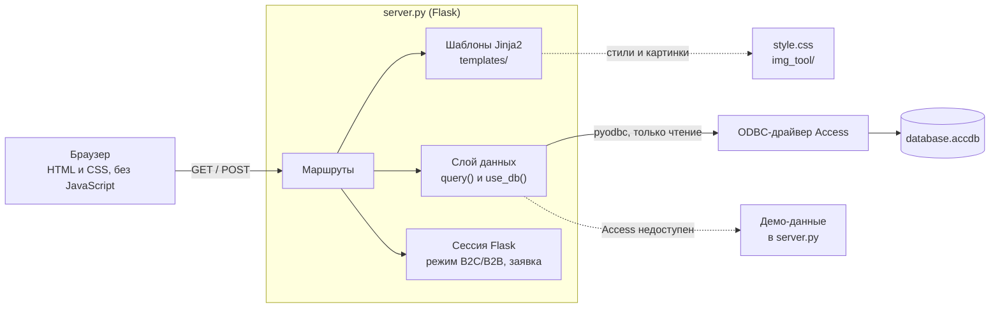
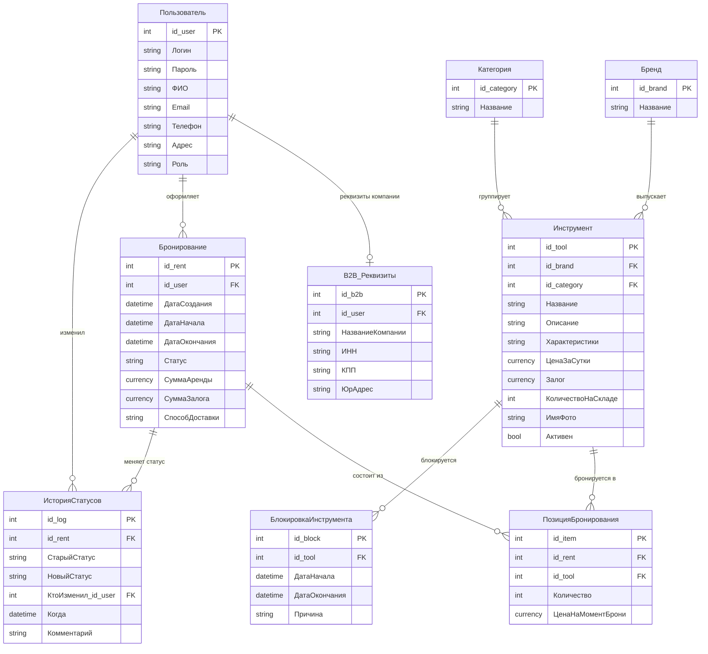

<h1 align="center">ToolRent</h1>

<p align="center">
  <b>Аренда строительного инструмента: найти, выбрать срок, собрать заявку.</b><br>
  Каталог для частных клиентов, режим для строительных компаний, тёмный интерфейс со стеклянными панелями и ни одной строки JavaScript.
</p>

<p align="center">
  
  
  
  
  
  
</p>

<p align="center">
  <a href="#возможности">Возможности</a> ·
  <a href="#быстрый-запуск">Быстрый запуск</a> ·
  <a href="#подключение-databaseaccdb">База Access</a> ·
  <a href="#er-диаграмма">ER-диаграмма</a> ·
  <a href="#статус-проекта-и-ограничения">Статус</a>
</p>

> [!NOTE]
> **Учебный проект.** Каталог читается из базы Access; оформление заявки, вход, регистрация и кабинет компании пока существуют как интерфейсные макеты. Подробности — в разделе [Статус проекта и ограничения](#статус-проекта-и-ограничения).

## Содержание

- [О проекте](#о-проекте)
- [Возможности](#возможности)
- [Технологии](#технологии)
- [Архитектура](#архитектура)
- [Структура репозитория](#структура-репозитория)
- [Быстрый запуск](#быстрый-запуск)
- [Требования](#требования)
- [Подключение database.accdb](#подключение-databaseaccdb)
- [Маршруты и возможности приложения](#маршруты-и-возможности-приложения)
- [База данных](#база-данных)
- [ER-диаграмма](#er-диаграмма)
- [Изображения инструментов](#изображения-инструментов)
- [Статус проекта и ограничения](#статус-проекта-и-ограничения)
- [Дорожная карта](#дорожная-карта)

## О проекте

**ToolRent** — веб-сайт аренды строительного инструмента: перфораторов, шуруповёртов, шлифовального оборудования, генераторов, измерительной техники, строительных лесов. Логика каталога и аренды ориентирована на удобство: поиск, категории, фильтры, цена за сутки, размер залога и остаток на складе видны сразу.

Визуальный язык проекта: тёмная тема, крупная типографика, стеклянные панели (glassmorphism) и плавные CSS-анимации. Интерфейс переключается между режимами **«Частным»** и **«Бизнесу»**: меняются тексты, акцентный цвет и состав блоков.

Главное ограничение, которое стало дизайн-решением: **весь интерфейс работает без JavaScript**: только HTML-формы, GET/POST-запросы Flask и CSS.

## Возможности

| Каталог | Карточка инструмента | Заявка на аренду |
|---|---|---|
| • Поиск по названию и бренду<br>• Фильтры: категория, бренд, «только в наличии»<br>• Сортировка: по умолчанию, дешевле, дороже, по названию<br>• Карточка: бренд, модель, фото, цена за сутки, залог, остаток | • Крупное фото, описание и характеристики<br>• Выбор срока: 1, 3, 7, 14 или 30 суток<br>• Итоговая стоимость для каждого срока видна сразу<br>• До трёх похожих инструментов из той же категории | • Боковая панель вместо корзины, страница под ней не перезагружается<br>• Добавление, удаление и очистка позиций<br>• Предварительный расчёт аренды и залога<br>• Заявка хранится в сессии Flask |

| Режимы B2C / B2B | Личные страницы | B2B-макеты |
|---|---|---|
| • Переключатель в шапке<br>• Меняются заголовок и тексты главной<br>• Акцентный цвет: янтарный для частных клиентов, голубой для бизнеса<br>• В режиме B2B на главной появляется блок мониторинга снабжения | • Страницы входа, регистрации, профиля и оформления<br>• Формы и вёрстка готовы<br>• Данные пока нигде не сохраняются, сайт сообщает об этом уведомлением | • Дашборд снабжения, зона загрузки сметы, карта объектов, бизнес-баланс, роли, блок «Скоро»<br>• Все показатели помечены **«демо»**<br>• Загруженный файл не читается и не сохраняется |

<details>
<summary><b>Как всё это работает без JavaScript</b></summary>

<br>

| Задача | Как решена |
|---|---|
| Боковая панель заявки | CSS-селектор `:target`: ссылка `#cart` открывает панель, `#close` закрывает |
| Остаться на той же странице после «В заявку» | POST на `/cart/add`, затем редирект обратно на ту же страницу с якорем `#cart` |
| Переключатель Частным / Бизнесу | Ссылка `/mode/<b2c\|b2b>`, режим хранится в сессии Flask |
| Фильтры и поиск каталога | Обычная GET-форма, параметры попадают в адрес страницы |
| Выбор срока аренды | Радиокнопки и CSS-состояние `:checked` |
| Бегущая строка тегов, плавающие элементы, пульс меток на карте | CSS-анимации (`@keyframes`) |
| Уведомления | Flask `flash()` и CSS-анимация появления и исчезновения |
| Адаптация и тёмная тема | CSS-переменные, `grid`, `flex`, `@media`, `prefers-reduced-motion` |

</details>

## Технологии

| Область | Что используется |
|---|---|
| Серверная часть | Python 3, Flask |
| Шаблоны | Jinja2 |
| Клиентская часть | HTML5, CSS3 (JavaScript не используется) |
| База данных | Microsoft Access (`database.accdb`) |
| Доступ к базе | `pyodbc` и драйвер Microsoft Access Database Engine (ODBC) |
| Состояние | Сессии Flask: режим B2C/B2B и содержимое заявки |

## Архитектура



Весь Python-код находится в одном файле `server.py`. Если Access недоступен (нет `pyodbc`, драйвера или файла), сайт не падает: показывает демонстрационные данные и печатает причину в консоль.

## Структура репозитория

```text
ToolRent/
├── server.py          # Flask-приложение: маршруты, доступ к Access, демо-данные
├── style.css          # дизайн-система и стили всех страниц
├── database.accdb     # база данных Microsoft Access
├── README.md
│
├── img_tool/          # фотографии инструментов и иллюстрации категорий
│
└── templates/         # HTML-шаблоны Jinja2
    ├── base.html      # шапка, подвал, боковая панель заявки, макрос карточки
    ├── index.html     # главная
    ├── catalog.html   # каталог и фильтры
    ├── tool.html      # страница инструмента
    ├── booking.html   # оформление аренды (макет)
    ├── login.html     # вход (макет)
    ├── register.html  # регистрация (макет)
    ├── profile.html   # личный кабинет (макет)
    └── b2b.html       # кабинет компании (макет)
```

Файла `requirements.txt` в репозитории пока нет: зависимости устанавливаются командой из раздела [Быстрый запуск](#быстрый-запуск).

## Быстрый запуск

```powershell
git clone https://github.com/<ваш-аккаунт>/ToolRent.git
cd ToolRent
pip install Flask pyodbc
python server.py
```

Сайт откроется на **http://127.0.0.1:5000**.

- Закройте `database.accdb` в Access перед запуском.
- Если драйвера Access нет, сайт всё равно запустится на демонстрационных данных. Над списком появится соответствующая пометка.
- Режим отладки Flask включён (`debug=True`): это режим для разработки.

## Требования

| Что | Подробности |
|---|---|
| ОС | **Windows** для работы с Access. Демо-режим без базы запускается и на других системах |
| Python | 3.9 или новее (проект проверялся на 3.12) |
| Пакеты | `Flask`, `pyodbc` |
| Драйвер | [Microsoft Access Database Engine](https://www.microsoft.com/en-us/download/details.aspx?id=54920) (драйвер «Microsoft Access Driver (\*.mdb, \*.accdb)») |

> [!IMPORTANT]
> **Разрядность Python и драйвера Access должна совпадать** (64-бит и 64-бит). Узнать разрядность Python:
> ```powershell
> python -c "import struct; print(struct.calcsize('P') * 8)"
> ```

## Подключение database.accdb

Файл `database.accdb` лежит **в корне проекта рядом с `server.py`**: путь и параметры подключения заданы в начале раздела работы с базой в `server.py`.

- Подключение работает в режиме **только чтение** (`ReadOnly=1`): сайт ничего не записывает в базу.
- Читаются таблицы `Инструмент`, `Бренд` и `Категория`; в каталог попадают только записи с `Активен = Да`.
- SQL-запросы параметризованы (`?`), порядок сортировки выбирается из белого списка.
- Остальные таблицы базы подключатся на следующих этапах.

**Проверка подключения.** Откройте **http://127.0.0.1:5000/db-check**. Временная страница показывает версию Python и её разрядность, найденные драйверы Access, результат подключения, количество строк в таблицах, названия и типы колонок (с отметкой отсутствующих полей), а также итоги по каталогу: активные инструменты, записи без фото. Содержимое таблиц она не выводит и открывается только с локального компьютера.

> [!NOTE]
> Страница `/db-check` временная и будет удалена после проверки подключения.

<details>
<summary><b>Если что-то пошло не так</b></summary>

<br>

| Симптом | Что проверить |
|---|---|
| На сайте пометка «Данные демонстрационные» | Причина напечатана в консоли строкой `[ToolRent] Access недоступен…` |
| Ошибка `IM002` или «Источник данных не найден» | Не установлен драйвер Access или не совпадает разрядность Python и драйвера |
| `pyodbc` не установлен | `pip install pyodbc` |
| Ошибка доступа к файлу | Закройте `database.accdb` в Access; рядом не должно быть блокирующего файла `.laccdb` |
| Каталог пуст | В таблице `Инструмент` нет записей с `Активен = Да` |
| Вместо фото иллюстрация | Имя файла в `ИмяФото` не совпадает с файлом в `img_tool/` |

</details>

## Маршруты и возможности приложения

| Маршрут | Метод | Что делает |
|---|---|---|
| `/` | GET | Главная: Hero, бегущая строка тегов, категории, четыре активных инструмента с наибольшим `id_tool`. В режиме B2B: макет блока мониторинга |
| `/catalog` | GET | Каталог. Параметры: `q`, `cat`, `brand`, `avail=1`, `sort=price_asc\|price_desc\|name` |
| `/tool/<id>` | GET | Страница инструмента: описание, характеристики, срок аренды, похожие |
| `/mode/<b2c\|b2b>` | GET | Переключение режима клиента, возврат на прежнюю страницу |
| `/cart/add` | POST | Добавить инструмент и срок в заявку |
| `/cart/remove/<id>` | POST | Убрать позицию из заявки |
| `/cart/clear` | POST | Очистить заявку |
| `/booking` | GET, POST | Сводка заявки и форма оформления. **Макет**: заявка не сохраняется |
| `/login`, `/register` | GET, POST | Формы входа и регистрации. **Макет**: данные не сохраняются |
| `/profile` | GET | Личный кабинет с демонстрационным содержимым |
| `/b2b` | GET | Макет кабинета компании |
| `/b2b/upload` | POST | Форма загрузки сметы. **Макет**: файл не читается и не сохраняется |
| `/style.css`, `/img/<имя>` | GET | Стили (из корня проекта) и изображения (из `img_tool/`) |
| `/db-check` | GET | Временная диагностика подключения к Access |

## База данных

База `database.accdb` содержит 9 таблиц с русскими названиями. Сейчас сайт читает три из них, остальные подготовлены для следующих этапов.

| Таблица | Назначение | Используется сайтом |
|---|---|---|
| `Инструмент` | Карточки инструментов: цена за сутки, залог, остаток, фото, активность | ✅ чтение |
| `Бренд` | Справочник брендов | ✅ чтение |
| `Категория` | Справочник категорий | ✅ чтение |
| `Пользователь` | Учётные записи: логин, пароль, контакты, роль | планируется |
| `B2B_Реквизиты` | Реквизиты компании пользователя | планируется |
| `Бронирование` | Заявки на аренду: даты, статус, суммы, способ получения | планируется |
| `ПозицияБронирования` | Инструменты внутри заявки с ценой на момент брони | планируется |
| `БлокировкаИнструмента` | Периоды, когда инструмент недоступен (например, ремонт) | планируется |
| `ИсторияСтатусов` | Журнал изменений статусов заявок | планируется |

B2B-клиент не является отдельной ролью с подаккаунтами: у пользователя могут быть реквизиты компании в `B2B_Реквизиты`.

## ER-диаграмма

Диаграмма отрисовывается самим GitHub. В её правом нижнем углу появляются кнопки **приближения, отдаления, перемещения и сброса**, так большую схему удобно рассматривать по частям. Дополнительно работает масштаб страницы браузера (`Ctrl` + `+`).



> [!NOTE]
> Схема описывает **логическую модель**: названия таблиц и полей совпадают с базой, а типы данных на диаграмме обобщённые (`int`, `string`, `currency`, `datetime`, `bool`) и не совпадают один в один с типами Access. Связи показаны по проектному описанию; ограничения целостности внутри самого `.accdb` могут быть заданы иначе.

## Изображения инструментов

- Фотографии лежат в папке **`img_tool/`**. Какой файл показать, определяет поле `ИмяФото` таблицы `Инструмент`: имя должно совпадать с именем файла **буква в букву, включая расширение** (например, `BoschGTC400C.jpg`).
- Сайт отдаёт файлы по адресу `/img/<имя файла>`.
- Если `ИмяФото` пусто или файла в `img_tool/` нет, вместо фото подставляется иллюстрация категории, без JavaScript и без битых картинок.
- В репозитории лежат шесть векторных иллюстраций-заглушек (`perforator.svg`, `drill.svg`, `grinder.svg`, `generator.svg`, `laser.svg`, `scaffold.svg`). Они же служат изображениями круглых категорий на главной: в таблице `Категория` поля для картинки нет, поэтому иллюстрация подбирается по началу слов в названии категории, а вручную её можно закрепить в словаре `CATEGORY_IMG_BY_ID` в `server.py`.

## Статус проекта и ограничения

| Статус | Что |
|---|---|
| ✅ Работает | Главная, каталог (поиск, фильтры, сортировка), страница инструмента, боковая панель заявки, переключатель B2C/B2B |
| ✅ Работает | Чтение каталога из Access (только чтение) и автоматический переход на демо-данные, если база недоступна |
| 🟡 Макет | Оформление аренды, вход, регистрация, личный кабинет |
| 🟡 Макет | B2B: показатели снабжения, загрузка сметы, карта объектов, баланс, роли, блок «Скоро». Все цифры демонстрационные |
| ⬜ Не реализовано | Авторизация, бронирование, проверка доступности по датам, блокировки, история статусов, реквизиты компании |

> [!WARNING]
> **Ограничения текущей версии**
> - Заявка хранится в сессии Flask (cookie) и **не записывается в базу**.
> - Количество «Доступно» берётся из `КоличествоНаСкладе` и пока **не учитывает** брони и блокировки.
> - Загруженная смета не анализируется, «AI-снабженец» только макет формы.
> - Секретный ключ сессий в `server.py` учебный и должен быть заменён перед любым размещением в интернете.
> - Режим отладки Flask включён, проект запускается как локальный.
> - Страница `/db-check` временная.

## Дорожная карта

| Этап | Что планируется | Таблицы |
|---|---|---|
| 1 | Подключение Access, чтение каталога | `Инструмент`, `Бренд`, `Категория` |
| 2 | Регистрация и вход | `Пользователь` |
| 3 | Бронирование, расчёт доступности с учётом блокировок | `Бронирование`, `ПозицияБронирования`, `БлокировкаИнструмента` |
| 4 | Личный кабинет и история аренды | `Бронирование`, `ИсторияСтатусов` |
| 5 | Реквизиты компании для бизнес-клиентов | `B2B_Реквизиты` |

Дальнейшие идеи для B2B (согласование заявок, список объектов, перемещение инструмента между объектами, подписка, электронный документооборот, расчёт налоговой выгоды) пока существуют только как визуальные заготовки.
