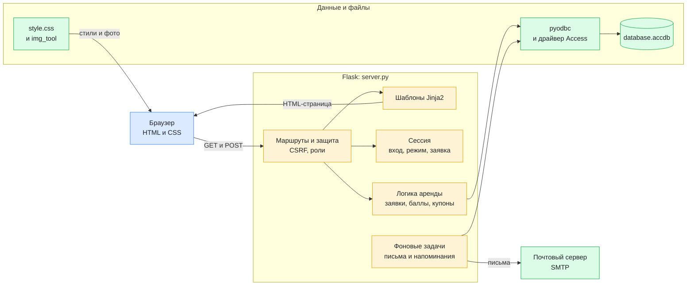
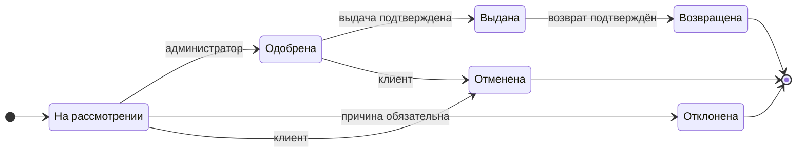
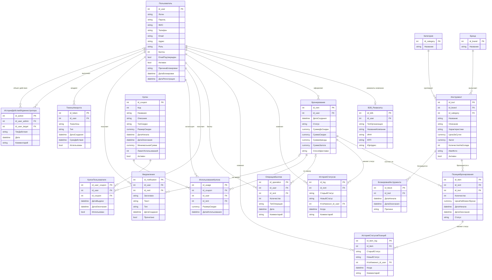

<h1 align="center">ToolRent</h1>

<p align="center">
  <b>Аренда строительного инструмента: найти, собрать заявку, получить и вернуть.</b><br>
  Каталог, личный кабинет, бонусные баллы и купоны, панель администратора. Тёмный интерфейс со стеклянными панелями и ни одной строки JavaScript.
</p>

<p align="center">
  
  
  
  
  
</p>

<p align="center">
  <a href="#возможности">Возможности</a> ·
  <a href="#быстрый-запуск">Быстрый запуск</a> ·
  <a href="#настройка">Настройка</a> ·
  <a href="#er-диаграмма">ER-диаграмма</a> ·
  <a href="#безопасность">Безопасность</a>
</p>

> [!NOTE]
> **ToolRent** — учебный проект: современный сайт аренды строительного инструмента для частных клиентов и строительных компаний.

## Содержание

- [О проекте](#о-проекте)
- [Возможности](#возможности)
- [Дизайн и интерфейс](#дизайн-и-интерфейс)
- [Технологии](#технологии)
- [Архитектура](#архитектура)
- [Структура репозитория](#структура-репозитория)
- [Быстрый запуск](#быстрый-запуск)
- [Требования](#требования)
- [Настройка](#настройка)
- [Подключение database.accdb](#подключение-databaseaccdb)
- [Роли и администратор](#роли-и-администратор)
- [Как проходит аренда](#как-проходит-аренда)
- [Баллы, купоны и оценочная выгода](#баллы-купоны-и-оценочная-выгода)
- [Уведомления и почта](#уведомления-и-почта)
- [Маршруты](#маршруты)
- [База данных](#база-данных)
- [ER-диаграмма](#er-диаграмма)
- [Изображения инструментов](#изображения-инструментов)
- [Безопасность](#безопасность)

## О проекте

**ToolRent** — веб-сайт аренды строительного инструмента: перфораторов, шуруповёртов, шлифовального оборудования, генераторов, измерительной техники, строительных лесов. В каталоге сразу видны цена за сутки, размер залога и свободное количество.

Клиент регистрируется, подтверждает почту и собирает **одну заявку из нескольких позиций**: у каждой позиции своё количество, свои даты и свой статус. Администратор рассматривает заявку по позициям: одобряет, отказывает с причиной, подтверждает выдачу и возврат. За завершённую аренду начисляются бонусные баллы, а купоны и личный кабинет собирают всю историю в одном месте.

Особенность проекта: **весь интерфейс работает без JavaScript**. Вся интерактивность построена на HTML-формах, GET/POST-запросах Flask и CSS.

## Возможности

| Каталог | Карточка инструмента | Заявка на аренду |
|---|---|---|
| • Поиск по названию и бренду<br>• Фильтры: категория, бренд, «только в наличии»<br>• Сортировка по цене и названию<br>• Свободное количество на сегодня с учётом броней и блокировок | • Крупное фото, описание и характеристики с сохранением абзацев<br>• Количество, дата начала и срок: 1, 3, 7, 14 или 30 суток<br>• Итоговая стоимость для каждого срока<br>• Похожие инструменты | • Боковая панель вместо корзины, страница под ней не перезагружается<br>• У каждой позиции свои количество и даты, один инструмент можно взять на разные сроки<br>• Проверка свободного количества на выбранные даты<br>• Купон и (при настройке) оплата части заказа баллами |

| Аккаунт | Личный кабинет | Администратор |
|---|---|---|
| • Регистрация, вход, выход, «запомнить меня»<br>• Подтверждение почты по ссылке и повторная отправка письма<br>• Восстановление и смена пароля<br>• Пароли хранятся только в виде хешей | • Личные данные, email, телефон, адрес<br>• История аренд с раскрывающимися позициями и статусами<br>• Баллы, купоны, сообщения<br>• Карта активности в стиле GitHub<br>• Оценочная выгода от аренды<br>• Подключение бизнес-профиля | • Инструменты с фотографиями, категории и бренды<br>• Заявки: обработка каждой позиции отдельно<br>• Пользователи: блокировка, ручное подтверждение почты, баллы, купоны, сообщения<br>• Купоны<br>• Журнал всех действий |

| Режимы B2C / B2B | Бизнес-профиль | Уведомления |
|---|---|---|
| • Переключатель в шапке<br>• Свои тексты главной для каждого режима<br>• Акцентный цвет: оранжевый для частных клиентов, голубой для бизнеса<br>• Реальные показатели склада на главной в режиме B2B | • Тип организации, название, ИНН, КПП, юридический адрес<br>• КПП необязателен для ИП и самозанятых<br>• Тот же аккаунт: заказы, баллы и купоны сохраняются<br>• Роль меняется с `user` на `b2b` | • Внутренние уведомления и письма<br>• Статусы заявок, отказы с причиной, выдача, возврат<br>• Напоминания о сроке возврата и просрочка<br>• Баллы, купоны, сообщения администратора |

<details>
<summary><b>Как всё это работает без JavaScript</b></summary>

<br>

| Задача | Как решена |
|---|---|
| Боковая панель заявки | CSS-селектор `:target`: ссылка `#cart` открывает панель, `#close` закрывает |
| Панель аккаунта в шапке | На компьютере открывается при наведении (`:hover`, `:focus-within`), на телефоне нажатием: скрытый чекбокс и `:checked` |
| Остаться на той же странице после «В заявку» | POST на `/cart/add`, затем редирект обратно на ту же страницу с якорем `#cart` |
| Переключатель Частным / Бизнесу | Ссылка `/mode/<b2c\|b2b>`, режим хранится в сессии Flask |
| Фильтры и поиск каталога | Обычная GET-форма |
| Выбор срока и способа получения | Радиокнопки и состояние `:checked` |
| Заявка с раскрывающимися позициями | HTML-элемент `<details>` |
| Карта активности | CSS-сетка из ячеек, оттенок зависит от числа событий за день |
| Защита форм | CSRF-токен в скрытом поле каждой формы |
| Анимации | CSS `@keyframes` и `transition` |

</details>

## Дизайн и интерфейс

Интерфейс ToolRent построен вокруг трёх идей: премиальная тёмная тема, стеклянные панели и крупная выразительная типографика.

| Принцип | Как это выглядит |
|---|---|
| Тёмная тема | Графитовый фон с мягкими цветными свечениями |
| Стеклянные панели | Полупрозрачные поверхности с лёгким размытием (`backdrop-filter`) только там, где оно нужно: шапка и карточки. Первый экран работает на градиентах |
| Типографика | Крупные заголовки с плотным трекингом, системные шрифты без внешних подключений |
| Два настроения | Оранжевый акцент для частных клиентов и голубой для бизнеса, переключаются одним нажатием |
| Движение | Плавающие элементы Hero, бегущая строка категорий, плавный выезд панелей |
| Категории | Крупные круглые плитки с эффектом увеличения при наведении |
| Адаптивность | Раскладка перестраивается под планшеты и телефоны |
| Доступность | Заметный фокус клавиатуры, учёт системной настройки «уменьшить движение» |

## Технологии

| Область | Что используется |
|---|---|
| Серверная часть | Python 3, Flask |
| Шаблоны | Jinja2 |
| Клиентская часть | HTML5, CSS3 (JavaScript не используется) |
| База данных | Microsoft Access (`database.accdb`) |
| Доступ к базе | `pyodbc` и драйвер Microsoft Access Database Engine (ODBC) |
| Пароли | Хеши PBKDF2-SHA256 (`werkzeug.security`, входит в состав Flask) |
| Почта | `smtplib` из стандартной библиотеки, отправка в фоновом потоке |
| Состояние | Сессии Flask: вход, режим B2C/B2B, содержимое заявки |

## Архитектура



Весь Python-код находится в одном файле `server.py`: маршруты, доступ к базе Access, логика аренды, письма и командная строка. Шаблоны, стили и изображения подключаются обычными средствами Flask.

## Структура репозитория

```text
ToolRent/
├── server.py          # Flask-приложение: маршруты, Access, аренда, почта, админ-команда
├── style.css          # дизайн-система и стили всех страниц
├── database.accdb     # база данных Microsoft Access
├── README.md
│
├── img_tool/          # фотографии инструментов и иллюстрации категорий
│
└── templates/         # HTML-шаблоны Jinja2
    ├── base.html      # шапка, панель аккаунта, подвал, боковая панель заявки
    ├── index.html     # главная
    ├── catalog.html   # каталог и фильтры
    ├── tool.html      # страница инструмента
    ├── booking.html   # оформление заявки
    ├── login.html     # вход
    ├── register.html  # регистрация
    ├── forgot.html    # восстановление пароля
    ├── message.html   # информационные страницы и ошибки
    ├── profile.html   # личный кабинет (все разделы)
    ├── b2b.html       # страница для строительных компаний
    └── admin.html     # панель администратора (все разделы)
```

Зависимости проекта: `Flask` и `pyodbc`, команда установки приведена в разделе [Быстрый запуск](#быстрый-запуск).

## Быстрый запуск

```powershell
git clone https://github.com/Dinosaurguk/ToolRent.git
cd ToolRent
pip install Flask pyodbc
python server.py
```

Сайт откроется на **http://127.0.0.1:5000**.

1. Закройте `database.accdb` в Access перед запуском.
2. Зарегистрируйтесь на сайте.
3. Назначьте себя администратором: `python server.py make-admin ВАШ_ЛОГИН` (подробнее в разделе [Роли и администратор](#роли-и-администратор)).
4. Чтобы письма уходили на почту, задайте переменные из раздела [Настройка](#настройка). Без них ссылки подтверждения и восстановления печатаются в консоль сервера, а администратор может подтвердить почту пользователя вручную.

## Требования

| Что | Подробности |
|---|---|
| ОС | **Windows** (драйвер Access работает только в ней) |
| Python | 3.9 или новее (проект проверялся на 3.12) |
| Пакеты | `Flask`, `pyodbc` |
| Драйвер | [Microsoft Access Database Engine](https://www.microsoft.com/en-us/download/details.aspx?id=54920) (драйвер «Microsoft Access Driver (\*.mdb, \*.accdb)») |

> [!IMPORTANT]
> **Разрядность Python и драйвера Access должна совпадать** (64-бит и 64-бит). Узнать разрядность Python:
> ```powershell
> python -c "import struct; print(struct.calcsize('P') * 8)"
> ```

## Настройка

Все секреты и параметры берутся из переменных окружения, в исходный код они не записываются. В PowerShell переменные задаются перед запуском в том же окне:

```powershell
$env:TOOLRENT_SECRET_KEY = "длинная-случайная-строка"
$env:TOOLRENT_SMTP_HOST = "smtp.example.com"
$env:TOOLRENT_SMTP_USER = "toolrent@example.com"
$env:TOOLRENT_SMTP_PASSWORD = "пароль-приложения"
python server.py
```

| Переменная | Назначение |
|---|---|
| `TOOLRENT_SECRET_KEY` | Ключ подписи сессий. Если не задан, при каждом запуске создаётся временный, и пользователи выходят из аккаунтов после перезапуска |
| `TOOLRENT_BASE_URL` | Адрес сайта для ссылок в письмах (например, `https://toolrent.example`). По умолчанию берётся из запроса |
| `TOOLRENT_SMTP_HOST`, `TOOLRENT_SMTP_PORT` | Почтовый сервер и порт (по умолчанию 587) |
| `TOOLRENT_SMTP_USER`, `TOOLRENT_SMTP_PASSWORD` | Логин и пароль почтового ящика |
| `TOOLRENT_SMTP_FROM` | Адрес отправителя (по умолчанию равен логину) |
| `TOOLRENT_SMTP_TLS` | `starttls` (по умолчанию), `ssl` или `none` |
| `TOOLRENT_POINT_RUB_RATE` | Сколько рублей скидки даёт 1 балл при оформлении заявки. Если не задана, списание баллов в оформлении не показывается |

Коэффициенты расчётов собраны в начале `server.py`: `POINTS_PERCENT` (процент начисления баллов) и `SAVINGS_COEF` (коэффициент «Оценочной выгоды от аренды»).

## Подключение database.accdb

Файл `database.accdb` лежит **в корне проекта рядом с `server.py`**. База содержит 17 таблиц, структуру менять не нужно.

- Все SQL-запросы параметризованы (`?`), порядок сортировки выбирается из белого списка.
- Изменения заявок, баллов и купонов выполняются в транзакциях: при ошибке откатывается всё сразу.
- Если база недоступна, сайт показывает страницу с причиной и подсказкой, а не пустой каталог.

**Проверка подключения.** Откройте **http://127.0.0.1:5000/db-check**. Страница показывает версию Python и её разрядность, найденные драйверы Access, результат подключения, количество строк в каждой из 17 таблиц и сверку названий колонок с ожидаемыми. Содержимое таблиц она не выводит и открывается только с локального компьютера.

<details>
<summary><b>Устранение неполадок</b></summary>

<br>

| Симптом | Что проверить |
|---|---|
| Страница «База данных недоступна» | Причина указана на странице; откройте `/db-check` |
| Ошибка `IM002` или «Источник данных не найден» | Установлен ли драйвер Access и совпадает ли разрядность Python и драйвера |
| `pyodbc` не установлен | `pip install pyodbc` |
| Ошибка доступа к файлу | Закройте `database.accdb` в Access; рядом не должно быть блокирующего файла `.laccdb` |
| `/db-check` показывает «НЕТ колонок» | Структура базы отличается от ожидаемой: сравните с разделом [База данных](#база-данных) |
| Письма не приходят | Проверьте переменные `TOOLRENT_SMTP_*`; ошибки отправки и повторные попытки печатаются в консоль |
| Вместо фото иллюстрация категории | Имя файла в `ИмяФото` не совпадает с файлом в `img_tool/` |

</details>

## Роли и администратор

| Роль | Кто это |
|---|---|
| `user` | Обычный пользователь. Регистрируется самостоятельно |
| `b2b` | Пользователь с подключённым бизнес-профилем. Тот же аккаунт: заказы, баллы, купоны и личные данные сохраняются |
| `admin` | Единственный главный администратор |

- При регистрации всегда создаётся роль `user`. Назначить себе `admin` через форму или запрос невозможно.
- Роль `b2b` выдаётся автоматически после заполнения реквизитов организации в личном кабинете.
- **Администратор назначается из командной строки** на уже зарегистрированного пользователя:

```powershell
python server.py make-admin ВАШ_ЛОГИН
```

  Команда не сработает, если администратор уже есть: в системе он может быть только один.
- Все административные маршруты проверяют роль на стороне сервера при каждом запросе; обычным пользователям они возвращают «Нет доступа». Заблокированный пользователь теряет доступ сразу, не дожидаясь окончания сессии.
- Каждое важное действие администратора записывается в журнал: дата, исполнитель, действие, пользователь и подробности. Среди них ручное подтверждение почты, блокировки, баллы, купоны, изменения инструментов и обработка позиций заявок.

## Как проходит аренда

Одна заявка (`Бронирование`) состоит из нескольких позиций (`ПозицияБронирования`). Позиции не объединяются в комплекты: это один заказ с раскрывающимся содержимым. Администратор обрабатывает каждую позицию отдельно.



| Статус заявки | Когда |
|---|---|
| На рассмотрении | Все позиции ждут решения |
| В обработке | Часть позиций одобрена или обработана, выдачи ещё не было |
| В аренде | Хотя бы одна позиция выдана |
| Завершена | Все позиции в конечном статусе, хотя бы одна возвращена |
| Отклонена / Отменена | Все позиции отклонены или отменены |

- **Доступность.** Инструмент занят на даты позиций со статусами «Одобрена» и «Выдана»; периоды из таблицы `БлокировкаИнструмента` делают его недоступным. Количество проверяется при оформлении и повторно при одобрении.
- **Пересчёт.** Если часть позиций отклонена, сумма аренды, скидка и залог заявки пересчитываются.
- **Отмена.** Клиент может отменить заявку, пока оборудование не выдано. Купон и списанные баллы возвращаются.
- **История.** Изменения статуса всей заявки хранятся в `ИсторияСтатусов`, а отдельных позиций в `ИсторияСтатусовПозиций`. Клиент видит текущую стадию и причину отказа в личном кабинете.
- **Подтверждённая почта.** Отправлять заявки могут пользователи с подтверждённым адресом электронной почты.

## Баллы, купоны и оценочная выгода

**Бонусные баллы**
- Начисляется 5% от стоимости аренды, залог не учитывается.
- Баллы начисляются только после того, как возвращены все позиции заявки; повторно за одну заявку они не начисляются.
- История начислений и списаний хранится в `ОперацииБаллов`. Администратор может начислять и списывать баллы вручную с комментарием.
- Оплата части заявки баллами включается переменной `TOOLRENT_POINT_RUB_RATE`.

**Купоны**
- Администратор создаёт купоны (процент или сумма, срок действия, минимальная сумма, лимит использований) и выдаёт их пользователям.
- Пользователь видит свои купоны в личном кабинете и выбирает купон при оформлении заявки; использование привязывается к конкретному заказу.
- Если заявка отклонена или отменена полностью, купон снова становится доступным.
- Код купона в базе числовой, поэтому генерируется автоматически.

**Оценочная выгода от аренды**
- Условная величина по завершённым арендам: стоимость аренды × (`SAVINGS_COEF` − 1), где коэффициент равен 2,325. Это расчёт, а не подтверждённая рыночная экономия, поэтому в интерфейсе она так и называется.

**Карта активности**
- Календарь за год в стиле GitHub строится по таблицам заявок, позиций и историй статусов. Видны создание заявок, одобрения, отказы, выдачи, возвраты, завершения и позиции, ожидающие решения.

## Уведомления и почта

Каждое событие создаёт внутреннее уведомление (раздел «Сообщения» с индикатором в шапке), а на подтверждённую почту уходит письмо.

| Событие | Уведомление |
|---|---|
| Регистрация | Письмо со ссылкой подтверждения |
| Изменение статуса заявки, одобрение, отказ с причиной | ✅ |
| Выдача оборудования, подтверждение возврата, завершение заявки | ✅ |
| Приближение срока возврата и просрочка | ✅ (проверка раз в 30 минут) |
| Начисление баллов, возврат баллов | ✅ |
| Получение купона | ✅ |
| Сообщение от администратора | ✅ |

- Письма отправляются в фоновом потоке: страница не ждёт ответа почтового сервера.
- При ошибке отправки выполняются повторные попытки через 1, 5 и 30 минут.
- Ссылки подтверждения почты и восстановления пароля одноразовые; в базе хранится только хеш токена. Срок действия: 24 часа и 1 час.
- Администратор получает внутренние уведомления о новых заявках и просрочках.

## Маршруты

| Группа | Маршруты |
|---|---|
| Публичные | `/` · `/catalog` (`q`, `cat`, `brand`, `avail=1`, `sort`) · `/tool/<id>` · `/b2b` · `/mode/<b2c\|b2b>` |
| Заявка | `/cart/add` · `/cart/remove/<ключ>` · `/cart/clear` · `/booking` |
| Аккаунт | `/register` · `/login` · `/logout` · `/verify/<токен>` · `/verify/resend` · `/forgot` · `/reset/<токен>` |
| Кабинет | `/profile` · `/profile/<раздел>`: `orders`, `points`, `coupons`, `messages`, `activity`, `password`, `business` · `/profile/orders/<id>` |
| Администратор | `/admin` · `/admin/orders` · `/admin/tools` · `/admin/dicts` · `/admin/users` · `/admin/coupons` · `/admin/journal` |
| Служебные | `/style.css` · `/img/<имя>` · `/db-check` |

## База данных

База `database.accdb` содержит 17 таблиц с русскими названиями.

| Группа | Таблица | Назначение |
|---|---|---|
| Каталог | `Инструмент` | Карточки: цена за сутки, залог, остаток, фото, активность |
| Каталог | `Бренд`, `Категория` | Справочники |
| Каталог | `БлокировкаИнструмента` | Периоды, когда инструмент недоступен (например, ремонт) |
| Пользователи | `Пользователь` | Учётная запись: хеш пароля, роль, баллы, подтверждение почты, блокировка |
| Пользователи | `B2B_Реквизиты` | Реквизиты организации пользователя |
| Пользователи | `ТокеныАккаунта` | Одноразовые токены подтверждения почты и восстановления пароля (хранятся хеши) |
| Аренда | `Бронирование` | Заявка: статус, суммы до и после скидки, залог, способ получения |
| Аренда | `ПозицияБронирования` | Позиция: количество, цена на момент брони, свои даты и статус |
| Аренда | `ИсторияСтатусов` | Журнал изменений статуса заявки |
| Аренда | `ИсторияСтатусовПозиций` | Журнал изменений статуса позиций |
| Баллы и купоны | `ОперацииБаллов` | Начисления, списания, возвраты |
| Баллы и купоны | `Купон`, `КупонПользователя`, `ИспользованиеКупона` | Купоны, их выдача пользователям и использование в заказах |
| Сервис | `Уведомления` | Внутренние сообщения пользователей |
| Сервис | `ИсторияДействийАдминистратора` | Журнал действий администратора |

B2B-клиент не является отдельной системой регистрации: у обычного пользователя появляются реквизиты в `B2B_Реквизиты`, а роль меняется на `b2b`.

## ER-диаграмма

Диаграмма отрисовывается самим GitHub. В её правом нижнем углу появляются кнопки **приближения, отдаления, перемещения и сброса**, так большую схему удобно рассматривать по частям. Дополнительно работает масштаб страницы браузера (`Ctrl` + `+`).



> Типы данных на диаграмме обобщены: `int`, `string`, `currency`, `datetime`, `bool`. Названия таблиц и полей совпадают с базой.

## Изображения инструментов

- Фотографии лежат в папке **`img_tool/`**. Какой файл показать, определяет поле `ИмяФото` таблицы `Инструмент`: имя должно совпадать с именем файла **буква в букву, включая расширение** (например, `BoschGTC400C.jpg`).
- Администратор загружает и заменяет фото прямо в карточке инструмента: допустимы JPG, PNG и WEBP до 5 МБ, формат проверяется по содержимому файла. Загруженные файлы сохраняются в `img_tool/` под именем вида `tool_<id>_<код>.jpg`; при замене прежний загруженный файл удаляется.
- Сайт отдаёт файлы по адресу `/img/<имя файла>`.
- Если у инструмента нет фото, вместо него показывается иллюстрация его категории, поэтому карточки всегда выглядят цельно.
- В папке лежат шесть векторных иллюстраций (`perforator.svg`, `drill.svg`, `grinder.svg`, `generator.svg`, `laser.svg`, `scaffold.svg`). Они же используются в круглых категориях на главной: иллюстрация подбирается по названию категории, а при необходимости её можно закрепить вручную в словаре `CATEGORY_IMG_BY_ID` в `server.py`.

## Безопасность

- Пароли хранятся только в виде хешей PBKDF2-SHA256 с солью.
- Все POST-формы защищены CSRF-токеном; сессионные cookie помечены `HttpOnly` и `SameSite=Lax`.
- SQL-запросы параметризованы; названия таблиц и колонок в запросах задаются в коде, а не приходят от пользователя.
- Роли проверяются на сервере в каждом административном маршруте; роль `admin` нельзя получить через регистрацию или профиль.
- Ограничение числа неудачных входов; ответ восстановления пароля не раскрывает, существует ли адрес.
- Ссылки подтверждения и восстановления одноразовые и ограничены по времени, в базе хранится только их хеш.
- Загружаемые фото проверяются по содержимому и размеру, SVG не принимаются.
- Секреты (ключ сессий, пароль почты) берутся из переменных окружения.
- Списание баллов и купонов выполняется условными запросами в транзакции: уйти в минус или применить купон дважды нельзя.
