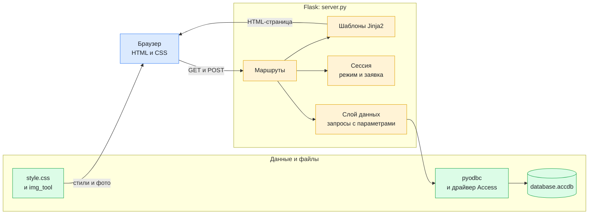
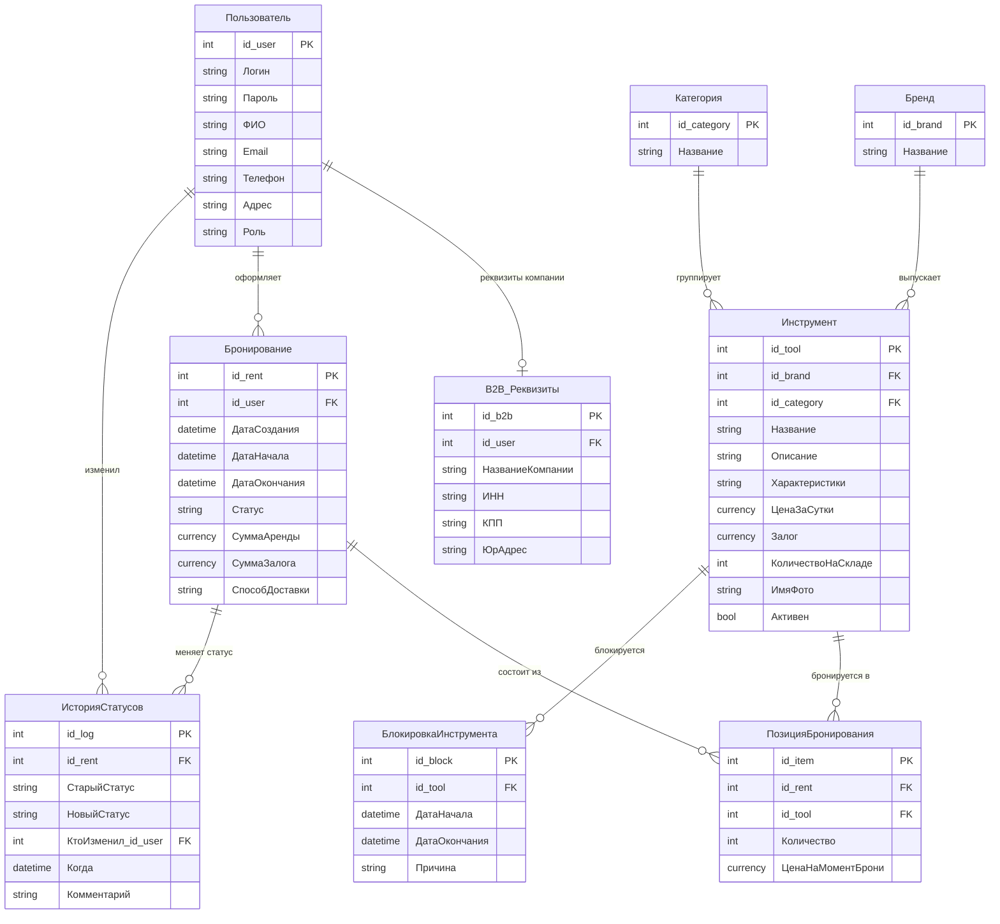

<h1 align="center">ToolRent</h1>

<p align="center">
  <b>Аренда строительного инструмента: найти, выбрать срок, собрать заявку.</b><br>
  Каталог для частных клиентов, режим для строительных компаний, тёмный интерфейс со стеклянными панелями и ни одной строки JavaScript.
</p>

<p align="center">
  
  
  
  
  
  
</p>

<p align="center">
  <a href="#возможности">Возможности</a> ·
  <a href="#быстрый-запуск">Быстрый запуск</a> ·
  <a href="#подключение-databaseaccdb">База Access</a> ·
  <a href="#er-диаграмма">ER-диаграмма</a> ·
  <a href="#дизайн-и-интерфейс">Дизайн</a>
</p>

> [!NOTE]
> **ToolRent** — учебный проект: современный сайт аренды строительного инструмента для частных клиентов и строительных компаний.

## Содержание

- [О проекте](#о-проекте)
- [Возможности](#возможности)
- [Дизайн и интерфейс](#дизайн-и-интерфейс)
- [Технологии](#технологии)
- [Архитектура](#архитектура)
- [Структура репозитория](#структура-репозитория)
- [Быстрый запуск](#быстрый-запуск)
- [Требования](#требования)
- [Подключение database.accdb](#подключение-databaseaccdb)
- [Маршруты и возможности приложения](#маршруты-и-возможности-приложения)
- [База данных](#база-данных)
- [ER-диаграмма](#er-диаграмма)
- [Изображения инструментов](#изображения-инструментов)

## О проекте

**ToolRent** — веб-сайт аренды строительного инструмента: перфораторов, шуруповёртов, шлифовального оборудования, генераторов, измерительной техники, строительных лесов. Логика каталога и аренды ориентирована на удобство: поиск, категории, фильтры, цена за сутки, размер залога и остаток на складе видны сразу.

Визуальный язык проекта: тёмная тема, крупная типографика, стеклянные панели (glassmorphism) и плавные CSS-анимации. Интерфейс переключается между режимами **«Частным»** и **«Бизнесу»**: меняются тексты, акцентный цвет и состав блоков.

Особенность проекта: **весь интерфейс работает без JavaScript**. Вся интерактивность построена на HTML-формах, GET/POST-запросах Flask и CSS.

## Возможности

| Каталог | Карточка инструмента | Заявка на аренду |
|---|---|---|
| • Поиск по названию и бренду<br>• Фильтры: категория, бренд, «только в наличии»<br>• Сортировка: по умолчанию, дешевле, дороже, по названию<br>• Карточка: бренд, модель, фото, цена за сутки, залог, остаток | • Крупное фото, описание и характеристики<br>• Выбор срока: 1, 3, 7, 14 или 30 суток<br>• Итоговая стоимость для каждого срока видна сразу<br>• До трёх похожих инструментов из той же категории | • Боковая панель вместо корзины, страница под ней не перезагружается<br>• Добавление, удаление и очистка позиций<br>• Предварительный расчёт аренды и залога<br>• Заявка хранится в сессии Flask |

| Режимы B2C / B2B | Личный кабинет | Для бизнеса |
|---|---|---|
| • Переключатель в шапке<br>• Свои тексты главной для каждого режима<br>• Акцентный цвет: янтарный для частных клиентов, голубой для бизнеса<br>• Блок мониторинга снабжения на главной в режиме B2B | • Страницы входа, регистрации и профиля<br>• Страница оформления аренды: даты и способ получения (самовывоз или доставка)<br>• Единый стиль со всем сайтом | • Отдельная страница для строительных компаний<br>• Мониторинг снабжения, зона загрузки сметы Excel или PDF, карта объектов, бизнес-баланс, роли сотрудников |

<details>
<summary><b>Как всё это работает без JavaScript</b></summary>

<br>

| Задача | Как решена |
|---|---|
| Боковая панель заявки | CSS-селектор `:target`: ссылка `#cart` открывает панель, `#close` закрывает |
| Остаться на той же странице после «В заявку» | POST на `/cart/add`, затем редирект обратно на ту же страницу с якорем `#cart` |
| Переключатель Частным / Бизнесу | Ссылка `/mode/<b2c\|b2b>`, режим хранится в сессии Flask |
| Фильтры и поиск каталога | Обычная GET-форма, параметры попадают в адрес страницы |
| Выбор срока аренды | Радиокнопки и CSS-состояние `:checked` |
| Бегущая строка тегов, плавающие элементы, пульс меток на карте | CSS-анимации (`@keyframes`) |
| Уведомления | Flask `flash()` и CSS-анимация появления и исчезновения |
| Адаптация и тёмная тема | CSS-переменные, `grid`, `flex`, `@media`, `prefers-reduced-motion` |

</details>

## Дизайн и интерфейс

Интерфейс ToolRent построен вокруг трёх идей: премиальная тёмная тема, стеклянные панели и крупная выразительная типографика.

| Принцип | Как это выглядит |
|---|---|
| Тёмная тема | Графитовый фон с мягкими цветными свечениями |
| Стеклянные панели | Полупрозрачные поверхности с размытием фона (`backdrop-filter`): шапка, карточки, панель заявки |
| Типографика | Крупные заголовки с плотным трекингом, системные шрифты без внешних подключений |
| Два настроения | Янтарный акцент для частных клиентов и голубой для бизнеса, переключаются одним нажатием |
| Движение | Плавающие элементы Hero, бегущая строка категорий, пульсирующие метки на карте, плавный выезд панели заявки |
| Категории | Крупные круглые плитки с эффектом увеличения при наведении |
| Адаптивность | Раскладка перестраивается под планшеты и телефоны |
| Доступность | Заметный фокус клавиатуры, учёт системной настройки «уменьшить движение» |

## Технологии

| Область | Что используется |
|---|---|
| Серверная часть | Python 3, Flask |
| Шаблоны | Jinja2 |
| Клиентская часть | HTML5, CSS3 (JavaScript не используется) |
| База данных | Microsoft Access (`database.accdb`) |
| Доступ к базе | `pyodbc` и драйвер Microsoft Access Database Engine (ODBC) |
| Состояние | Сессии Flask: режим B2C/B2B и содержимое заявки |

## Архитектура


Весь Python-код находится в одном файле `server.py`: маршруты, доступ к базе Access и работа с сессией. Шаблоны, стили и изображения подключаются обычными средствами Flask.

## Структура репозитория

```text
ToolRent/
├── server.py          # Flask-приложение: маршруты, доступ к Access, сессии
├── style.css          # дизайн-система и стили всех страниц
├── database.accdb     # база данных Microsoft Access
├── README.md
│
├── img_tool/          # фотографии инструментов и иллюстрации категорий
│
└── templates/         # HTML-шаблоны Jinja2
    ├── base.html      # шапка, подвал, боковая панель заявки, макрос карточки
    ├── index.html     # главная
    ├── catalog.html   # каталог и фильтры
    ├── tool.html      # страница инструмента
    ├── booking.html   # оформление аренды
    ├── login.html     # вход
    ├── register.html  # регистрация
    ├── profile.html   # личный кабинет
    └── b2b.html       # страница для строительных компаний
```

Зависимости проекта: `Flask` и `pyodbc`, команда установки приведена в разделе [Быстрый запуск](#быстрый-запуск).

## Быстрый запуск
```powershell
git clone https://github.com/Dinosaurguk/ToolRent.git
cd ToolRent
pip install Flask pyodbc
python server.py
```

Сайт откроется на **http://127.0.0.1:5000**.

- Перед запуском закройте `database.accdb` в Access.
- Для работы с каталогом нужны пакет `pyodbc` и драйвер Access, см. раздел [Требования](#требования).

## Требования

| Что | Подробности |
|---|---|
| ОС | **Windows** (драйвер Access работает только в ней) |
| Python | 3.9 или новее (проект проверялся на 3.12) |
| Пакеты | `Flask`, `pyodbc` |
| Драйвер | [Microsoft Access Database Engine](https://www.microsoft.com/en-us/download/details.aspx?id=54920) (драйвер «Microsoft Access Driver (\*.mdb, \*.accdb)») |

> [!IMPORTANT]
> **Разрядность Python и драйвера Access должна совпадать** (64-бит и 64-бит). Узнать разрядность Python:
> ```powershell
> python -c "import struct; print(struct.calcsize('P') * 8)"
> ```

## Подключение database.accdb
Файл `database.accdb` лежит **в корне проекта рядом с `server.py`**: путь и параметры подключения заданы в разделе работы с базой в `server.py`.

- Подключение работает в режиме **только чтение** (`ReadOnly=1`): сайт ничего не записывает в базу.
- Каталог строится из таблиц `Инструмент`, `Бренд` и `Категория`; показываются только записи с `Активен = Да`.
- SQL-запросы параметризованы (`?`), порядок сортировки выбирается из белого списка.

**Проверка подключения.** Откройте **http://127.0.0.1:5000/db-check**. Страница показывает версию Python и её разрядность, найденные драйверы Access, результат подключения, количество строк в таблицах, названия и типы колонок, а также итоги по каталогу: активные инструменты и записи без фото. Содержимое таблиц она не выводит и открывается только с локального компьютера.

<details>
<summary><b>Устранение неполадок</b></summary>

<br>

| Симптом | Что проверить |
|---|---|
| В каталоге нет данных из базы | Причина выводится в консоль сервера строкой `[ToolRent] Access недоступен…` |
| Ошибка `IM002` или «Источник данных не найден» | Установлен ли драйвер Access и совпадает ли разрядность Python и драйвера |
| `pyodbc` не установлен | `pip install pyodbc` |
| Ошибка доступа к файлу | Закройте `database.accdb` в Access; рядом не должно быть блокирующего файла `.laccdb` |
| Каталог пуст | В таблице `Инструмент` нет записей с `Активен = Да` |
| Вместо фото иллюстрация категории | Имя файла в `ИмяФото` не совпадает с файлом в `img_tool/` |

</details>

## Маршруты и возможности приложения
| Маршрут | Метод | Что делает |
|---|---|---|
| `/` | GET | Главная: Hero, бегущая строка тегов, категории, четыре активных инструмента с наибольшим `id_tool`. В режиме B2B добавляется блок мониторинга снабжения |
| `/catalog` | GET | Каталог. Параметры: `q`, `cat`, `brand`, `avail=1`, `sort=price_asc\|price_desc\|name` |
| `/tool/<id>` | GET | Страница инструмента: описание, характеристики, срок аренды, похожие инструменты |
| `/mode/<b2c\|b2b>` | GET | Переключение режима клиента, возврат на прежнюю страницу |
| `/cart/add` | POST | Добавить инструмент и срок в заявку |
| `/cart/remove/<id>` | POST | Убрать позицию из заявки |
| `/cart/clear` | POST | Очистить заявку |
| `/booking` | GET, POST | Сводка заявки и форма оформления аренды |
| `/login`, `/register` | GET, POST | Страницы входа и регистрации |
| `/profile` | GET | Личный кабинет |
| `/b2b` | GET | Страница для строительных компаний |
| `/b2b/upload` | POST | Форма загрузки сметы Excel или PDF |
| `/style.css`, `/img/<имя>` | GET | Стили (из корня проекта) и изображения (из `img_tool/`) |
| `/db-check` | GET | Диагностика подключения к Access (только с локального компьютера) |

## База данных
База `database.accdb` содержит 9 таблиц с русскими названиями. Каталог сайта формируется из таблиц `Инструмент`, `Бренд` и `Категория`.

| Группа | Таблица | Назначение |
|---|---|---|
| Каталог | `Инструмент` | Карточки инструментов: цена за сутки, залог, остаток, фото, активность |
| Каталог | `Бренд` | Справочник брендов |
| Каталог | `Категория` | Справочник категорий |
| Пользователи | `Пользователь` | Учётные записи: логин, пароль, контакты, роль |
| Пользователи | `B2B_Реквизиты` | Реквизиты компании пользователя |
| Аренда | `Бронирование` | Заявки на аренду: даты, статус, суммы, способ получения |
| Аренда | `ПозицияБронирования` | Инструменты внутри заявки с ценой на момент брони |
| Аренда | `БлокировкаИнструмента` | Периоды, когда инструмент недоступен (например, ремонт) |
| Аренда | `ИсторияСтатусов` | Журнал изменений статусов заявок |

B2B-клиент не является отдельной ролью с подаккаунтами: у пользователя могут быть реквизиты компании в `B2B_Реквизиты`.

## ER-диаграмма

Диаграмма отрисовывается самим GitHub. В её правом нижнем углу появляются кнопки **приближения, отдаления, перемещения и сброса**, так большую схему удобно рассматривать по частям. Дополнительно работает масштаб страницы браузера (`Ctrl` + `+`).



> Типы данных на диаграмме обобщены: `int`, `string`, `currency`, `datetime`, `bool`. Названия таблиц и полей совпадают с базой.

## Изображения инструментов
- Фотографии лежат в папке **`img_tool/`**. Какой файл показать, определяет поле `ИмяФото` таблицы `Инструмент`: имя должно совпадать с именем файла **буква в букву, включая расширение** (например, `BoschGTC400C.jpg`).
- Сайт отдаёт файлы по адресу `/img/<имя файла>`.
- Если у инструмента нет фото, вместо него показывается иллюстрация его категории, поэтому карточки всегда выглядят цельно.
- В папке лежат шесть векторных иллюстраций (`perforator.svg`, `drill.svg`, `grinder.svg`, `generator.svg`, `laser.svg`, `scaffold.svg`). Они же используются в круглых категориях на главной: иллюстрация подбирается по названию категории, а при необходимости её можно закрепить вручную в словаре `CATEGORY_IMG_BY_ID` в `server.py`.
